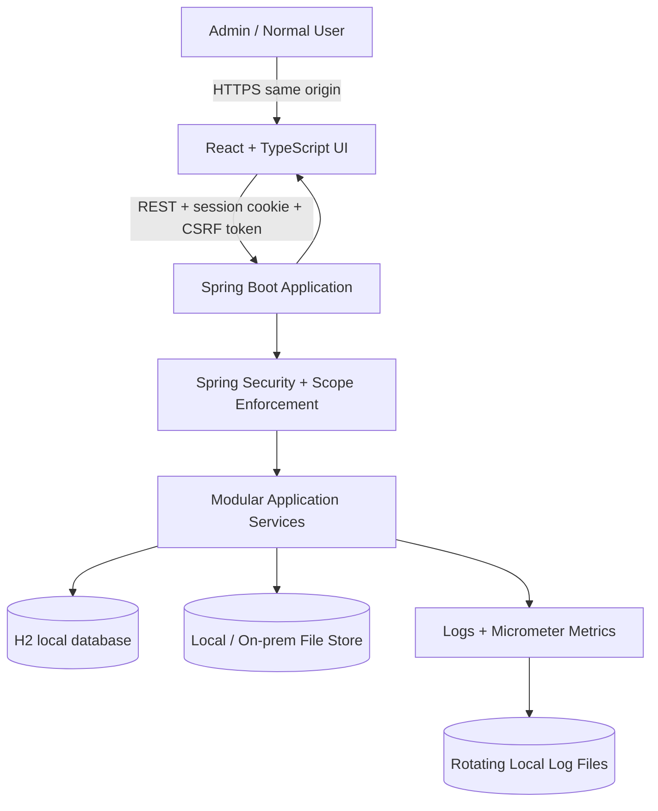
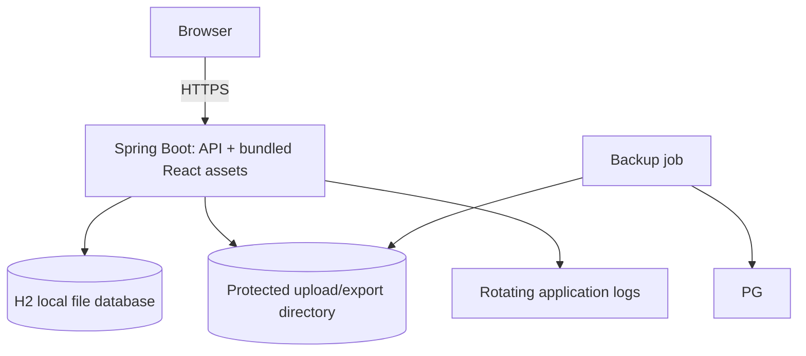
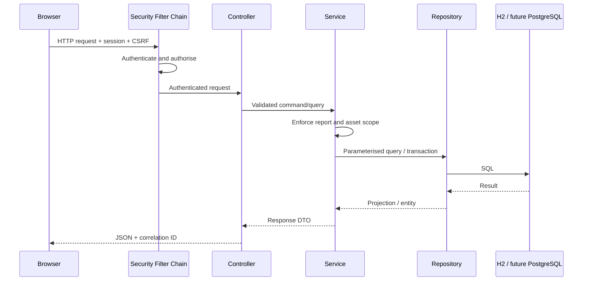
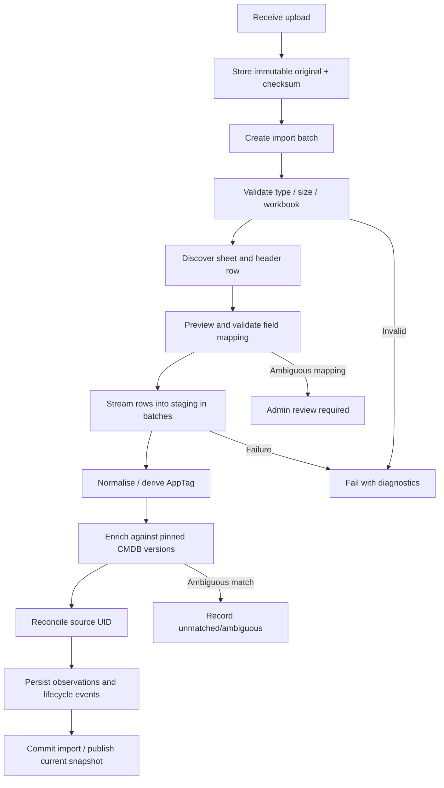
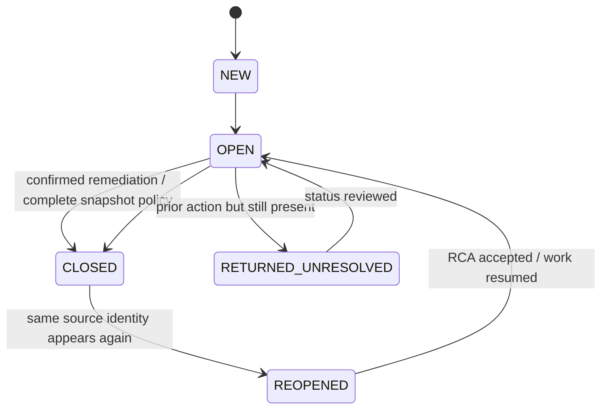
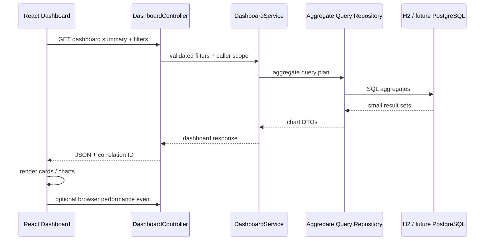

# VAPT Management Platform — Architecture

**Document status:** As-built architecture, verified 2026-11-16; the implementation-status addendum below is authoritative  
**Architecture style:** Modular monolith, layered backend, React SPA frontend  
**Primary runtime:** Java 21 LTS + Spring Boot 4.1.2 (current project version)  
**Database (current testing phase):** H2, file-backed for local development; in-memory for automated tests  
**Future database target:** PostgreSQL (migration after the H2 testing phase)  
**Runtime network policy:** No external third-party API, SaaS, telemetry or CDN dependency.

---

## 1. Architecture decisions at a glance

| Area | Decision | Reason |
|---|---|---|
| Application shape | Modular monolith | One deployable unit initially; clear module boundaries without distributed-system overhead |
| Backend | Java 21 + Spring Boot | Strong fit for security, file processing, transactional workflows and maintainable service layers |
| API | Spring MVC REST, same-origin | Clear contract between frontend and backend; session security remains simple |
| Frontend | React + TypeScript + Vite | Highly interactive dashboards, tables, filters, upload workflows and reusable components |
| Charts | Apache ECharts, bundled locally | Interactive charting without a hosted chart service |
| Database (now) | H2, local file-backed database for developer testing; in-memory H2 for automated tests | No external database installation is needed during the current phase |
| Future database | PostgreSQL, self-hosted/on-premises | Target for the later deployment/migration phase; validate SQL and migrations against a real PostgreSQL instance before cutover |
| Schema migration | Flyway | Versioned, repeatable database changes from the beginning |
| Authentication | Spring Security session authentication | Same-origin SPA; avoids unnecessary token lifecycle complexity |
| Password storage | BCrypt hash on the current application user record | Passwords are never stored in plain text; a separate provider boundary is a future SSO design option |
| File processing | Apache POI for Excel; Commons CSV or JDK reader for CSV | Controlled local parsing; no external conversion service |
| File storage | Local/on-premises file store, immutable originals | Raw workbook retention and data sovereignty |
| Logging | SLF4J + Logback structured output | Correlatable operational events and safe diagnostics |
| Metrics | Spring Boot Actuator + Micrometer | Built-in request, JVM, datasource and custom business timing metrics |
| External services | None required at runtime | No data egress or cloud dependency |

### 1.1 What “no third party” means in this design

This architecture assumes **no third-party hosted services or APIs**: no cloud database, hosted authentication, external analytics, external logging SaaS, public font CDN, public chart CDN, external file conversion, or external AI API.

React, ECharts, Apache POI, PostgreSQL and other open-source packages are still third-party software dependencies in the software-supply-chain sense. They are downloaded/approved during development or build, pinned and bundled/deployed within the organisation's environment. The running application does not call their public services. If the requirement literally prohibits all third-party libraries as well, React/ECharts/POI must be removed and replaced with custom browser code and JDK-only parsers where possible; that would materially increase implementation cost and maintenance risk.

### 1.2 Why React rather than Thymeleaf

This is a greenfield project with substantial client-side interaction:

- nested IP → application → AppTag navigation,
- many report sections sharing UI components,
- multi-filter dashboards and linked charts,
- asynchronous upload progress and import reconciliation summaries,
- editable comments/remediation actions,
- historical period selection and chart updates,
- admin diagnostics and audit history.

React's component model and state update model suit this interaction pattern. TypeScript makes API contracts and UI states more explicit. React's official documentation describes reusable components, conditional rendering, events and shared state as core concepts. [React documentation](https://react.dev/learn)

Thymeleaf is a legitimate Spring-integrated server-side template engine and is suitable for server-rendered forms and relatively simple pages. It does not remove the need for JavaScript for complex interactive charts and client-side state. [Thymeleaf Spring tutorial](https://www.thymeleaf.org/doc/tutorials/3.1/thymeleafspring.html)

**Chosen approach:** React + TypeScript frontend built into static assets and served from the Spring Boot application (or same-origin web server). No server-side Thymeleaf rendering in the first release. Do not split into separately deployed frontend and backend services initially.

If React is rejected because the organisation disallows all third-party JS libraries, the fallback is Spring MVC + Thymeleaf + vanilla JavaScript, accepting more manual UI-state code.

---

## 2. Logical system context



The browser communicates only with the VAPT application. The application communicates with its own database and controlled file store. There are no external API calls in the normal business flow.

## 3. Deployment topology

Current testing deployment is a single application instance using a local file-backed H2 database and a controlled file directory. Automated tests should use an isolated in-memory H2 database. PostgreSQL is a later migration target; do not require PostgreSQL to be installed for the current testing phase.



- Serve bundled frontend assets from the same origin to simplify cookies and CSRF.
- Use TLS at the application server or an organisation-managed reverse proxy.
- Store uploads outside the public web root with generated storage names.
- Store secrets outside source files (environment variables or an approved local secret store). Git is not part of the current workflow.
- Back up the H2 database file and the original-file store independently; test restoration. When PostgreSQL is introduced, define and test PostgreSQL backup/restore separately.
- No Docker requirement is imposed. Containers may be adopted by the deployment team but are not a prerequisite for development.

## 4. Backend architecture

Use a **modular monolith**. Each module owns its application rules, services and persistence contracts. Avoid one giant service class and avoid premature microservices.

Package-by-feature with layered packages is used in the current source tree. Business logic stays inside feature roots; common packages contain cross-feature infrastructure only. The current package tree is:

```text
com.company.vapt
├── VaptApplication
├── security/                         Spring Security chains and password encoder
├── common/
│   ├── exception/                    API error mapping and shared exceptions
│   ├── logging/                      correlation ID filter and log context
│   ├── observability/                performance timing and metrics helpers
│   └── response/                     shared API/page response DTOs
├── user/
│   ├── controller/                   auth and ADMIN account/scope endpoints
│   ├── service/                      authentication, activation, scopes, password policy
│   ├── repository/                   user, scope and activation persistence access
│   ├── domain/                       AppUser and UserScope models
│   ├── entity/                       activation-token persistence entity
│   └── dto/{request,response}/       external account/auth contracts
├── report/
│   ├── controller/                   report-section catalog endpoints
│   ├── domain/                       section IDs, metadata and registry
│   ├── entity/, repository/          section catalog persistence
│   └── dto/response/                 section API DTOs
├── ingestion/
│   ├── controller/                   import upload/history/status endpoints
│   ├── service/                      import lifecycle, parsers and row persistence
│   ├── repository/, entity/          source files, batches and stages
│   ├── domain/, dto/                  statuses and API contracts
│   └── storage/                      local immutable-file storage adapter
├── cmdb/
│   ├── controller/, service/         dataset upload, profiling and versioning
│   ├── repository/, entity/          dataset/version/record persistence
│   ├── domain/                       dataset types
│   └── storage/                      CMDB file adapter
├── enrichment/
│   ├── controller/, service/         report-to-CMDB matching orchestration
│   ├── repository/, entity/          enrichment results and runs
│   └── domain/                       matching and normalisation types
├── finding/
│   ├── controller/                   workspace and export REST controllers
│   ├── service/                      workspace, reconciliation, lifecycle and export orchestration
│   ├── repository/, entity/          findings, observations, events, comments, RCA and remediation
│   └── dto/response/                 workspace/dashboard/history/comment contracts
└── audit/
    ├── controller/, service/         ADMIN audit API and write service
    ├── repository/                   audit persistence access
    └── domain/                       audit event model
```

The current code has standalone roots for `user`, `report`, `ingestion`, `cmdb`, `enrichment`, `finding`, and `audit`. Reconciliation, comment, remediation, dashboard and export behavior still share the `finding` aggregate because their services directly coordinate finding identity and scope. They are not presented as separate module roots yet. Several services still access another feature's repository directly (notably enrichment and reconciliation). The package move establishes recognizable layers, but these repository-boundary violations remain an explicit architecture limitation for a later focused refactor; do not add a facade that merely forwards repository methods.

Controllers delegate operations to services; repositories own database access; entities are not returned as API contracts. `domain` remains for genuine business models. `common` and `security` are limited to reusable cross-feature infrastructure.### 4.1 Request flow



Controllers should be thin. Business rules belong in application/domain services. Repositories own persistence queries. DTOs should prevent entity leakage and avoid returning unnecessary columns.

### 4.2 Transaction boundaries

- Authentication and ordinary reads use read-only transactions where practical.
- Comment/remediation changes use short transactions and append audit events in the same transaction.
- A report import is orchestrated as a long-running job; do not hold one database transaction open for the entire file parse.
- Stage rows in batches, validate/reconcile, then atomically switch the current import/snapshot reference only after successful completion.
- A failed import remains diagnosable and cannot partially become the active weekly dataset.

---

## 5. Frontend architecture

Suggested frontend structure:

```text
frontend/
  src/
    app/
      App.tsx
      router.tsx
      providers/
    api/
      httpClient.ts
      contracts/
    components/
      layout/
      tables/
      filters/
      charts/
      feedback/
    features/
      auth/
      executive-dashboard/
      reports/
      cmdb/
      comments/
      remediation/
      import-history/
      audit/
      administration/
      diagnostics/
    styles/
    telemetry/
```

### 5.1 UI rules

- React components own local presentation state; API state is fetched through a small shared API layer.
- Keep API contracts explicit using TypeScript types.
- Dashboard components request aggregates; they do not download complete finding datasets.
- Data tables use server-side pagination/filter/sort.
- Charts update from API response DTOs, not by loading all raw findings.
- All static assets, fonts and chart libraries are bundled locally.
- No analytics beacon, remote font, CDN or external script.
- Use CIBIL-inspired blue/yellow design tokens. Use official logo/font files only after approval.

### 5.2 Browser performance instrumentation

The frontend must mark these milestones:

- `app.navigation.start`
- `dashboard.api.start` / `dashboard.api.end`
- `dashboard.data.received`
- `dashboard.react.render.start` / `dashboard.react.render.end`
- `dashboard.charts.render.start` / `dashboard.charts.render.end`
- `dashboard.ready`

Send a minimal telemetry event to the backend only for approved diagnostics, carrying request/correlation IDs, route template, duration, payload size and outcome. Do not send report rows, filters containing sensitive values, comments or credentials. Where possible, use browser performance measurements locally and aggregate without recording user-identifying details.

---

## 6. Data architecture

### 6.1 Database principles

- H2 is the database for the current local testing phase. Use a file-backed H2 URL for manual development so data survives application restarts; use in-memory H2 for automated tests. Keep the database file outside distributable source packages and protect it as sensitive data.
- PostgreSQL is a future migration target, not a current prerequisite.
- Use Flyway migrations from the beginning. Do not use Hibernate `ddl-auto=update` as the schema migration mechanism; use Flyway for schema changes and Hibernate validation where appropriate.
- Keep migrations and repository SQL as database-portable as practical: avoid H2-only functions, vendor-specific types, implicit identifier case assumptions and vendor-specific SQL until PostgreSQL migration work begins.
- Use stable table structures with `import_id`, version and effective-time references. Do not create physical tables for every weekly/CMDB version.
- Use internal generated IDs as primary keys; retain source UID/Finding ID as external identifiers.
- Apply composite indexes based on measured query patterns and H2 query plans now; repeat query-plan and index validation on PostgreSQL after migration.
- Represent application timestamps as UTC instants (`Instant`) and verify storage/round-trip behaviour on both database platforms.
- Avoid one-to-many joins in high-volume dashboard paths when aggregation DTO queries can answer the same question.
- H2 PostgreSQL compatibility mode, if enabled for a test, is only a convenience; it is not proof that PostgreSQL behaviour is compatible. Run integration tests against a real PostgreSQL instance before production cutover.

### 6.2 Proposed logical entities

This is a logical starting model, not a final SQL migration. Exact columns and constraints are refined after schema review.

Use stable code keys for these definitions: `GDP_VA_REPORT`, `INTERNAL_VA_BRINQA`, `WIZ`, `VERIZON_26_NETWORK_PT`, `PT_VERIZON_GCP` and `APPSEC_FINDINGS_PT`. Each key has its own upload/import namespace and report-specific dashboard/data filters. The first five general sections support Comments/remediation; `APPSEC_FINDINGS_PT` does not expose Comments until its mapping workflow is approved.

| Entity | Purpose |
|---|---|
| `report_section` | Six controlled report-section definitions: GDP VA Report, Internal VA Brinqa, Wiz, VERIZON 26 Network PT, PT Verizon GCP and AppSec Findings PT |
| `app_user` | Login identity, normalized email, role/status, BCrypt password hash and lockout metadata |
| `role` / `user_role` | ADMIN and USER role assignments |
| `asset` | Stable internal asset identity, hostname/IP attributes |
| `user_scope` | User-to-asset/application scope mappings |
| `cmdb_dataset` | The three CMDB dataset types |
| `cmdb_version` | Version metadata, checksum, upload/activation state |
| `cmdb_record_*` | Normalised records for HeadCount, JAS and ApplicationInventory |
| `source_file` | Immutable file metadata and controlled file-store reference |
| `import_batch` | Import status, report section, counts, durations, CMDB versions used |
| `finding` | Stable internal finding identity and current lifecycle state |
| `finding_observation` | One source observation per finding per import batch |
| `finding_event` | New/open/close/reopen/return and status transitions |
| `finding_mapping` | Finding-to-asset/application/owner enrichment and match provenance |
| `comment_thread` / `comment` | Comments in report/IP/application/AppTag context |
| `remediation_event` | Individual remediation action/date and user attribution |
| `rca_record` | Required RCA for reopened findings |
| `dashboard_snapshot` (or aggregate tables) | Optional persisted historical aggregates after measured need |
| `audit_event` | Durable user/business action history |

AppSec-specific fields may use a dedicated extension table or report-specific finding table. Do not force AppSec-specific columns into a large nullable generic table without a clear reason.

### 6.3 Finding identity

For the five general report sections (GDP VA Report, Internal VA Brinqa, Wiz, VERIZON 26 Network PT and PT Verizon GCP), expected source identity is `(report_section_id, source_uid)` after verifying UID uniqueness and stability. GDP VA Report and Internal VA Brinqa are distinct sections and must not share an import namespace. For AppSec Findings PT, use the confirmed source Finding ID. The internal `finding_id` is always the primary key for relationships.

If a UID is blank, duplicated within the same source import, or unstable across imports, mark the row for identity resolution; do not silently merge records using IP/AppTag alone.

### 6.4 Observation versus current state

`finding` represents the current canonical lifecycle state. `finding_observation` records what each weekly upload reported. `finding_event` records state transitions. This separation is required for weekly/monthly as-of history and for explaining why a finding was considered open, closed or reopened at a given time.

### 6.5 AppTag aggregation and remediation

The Comments page groups findings by IP → application → AppTag and displays Critical/High/Medium/Low counts. Because a single AppTag may contain many distinct findings, remediation changes must remain traceable to individual finding identities. The AppTag row is an aggregate view, not a replacement for finding-level lifecycle data.

The exact comment scope (AppTag group or individual finding) will be confirmed during UX design. The data model should support both without losing author/timestamp history.

---

## 7. Import and CMDB architecture

### 7.1 Report import pipeline



### 7.2 Large file handling

- CSV: buffered streaming parser.
- XLSX: Apache POI streaming/event model for large workbooks rather than loading the full workbook object graph when volume requires it.
- Batch staging writes with configurable batch size.
- Keep memory use bounded by a small number of rows plus parser buffers.
- Separate raw-file storage from relational staging.
- Capture progress by stage and row count; progress is an operational event, not a reason to log every row.

### 7.3 Dynamic sheet/header detection

- Inspect workbook sheet names, visible/hidden state, dimensions and candidate header rows.
- Normalise header labels for matching (case, whitespace, punctuation) while retaining original headers.
- Score candidate sheets/rows against required/known column aliases and value patterns.
- FQDN column detection in JAS should use header hints plus value profiling. Because the actual header is unknown, the importer must present a preview and let an admin confirm the FQDN column when confidence is not high.
- Persist the selected sheet, header row and column mapping with the CMDB version/import metadata.
- Do not hardcode worksheet names.

### 7.4 CMDB version activation

Each CMDB dataset has an active version pointer. New uploads are staged and validated first. Activation is a separate controlled operation. Existing report imports retain references to the CMDB versions used at enrichment time.

### 7.5 Matching rules

1. Classify report `Targets` as IP or hostname/FQDN.
2. IP → exact JAS `IP Address` match.
3. FQDN → exact match against the confirmed FQDN-values column.
4. Fallback FQDN normalisation → compare normalised short host with JAS `Host`.
5. JAS `OwnedBy` → HeadCount `Preferred Name`.
6. JAS `Application ID` → ApplicationInventory `ApplicationId`.
7. Retrieve IP, Tu_AppName, Environment, owner, public-facing flag, HeadCount metadata and application owners.
8. Mark `MATCHED`, `UNMATCHED` or `AMBIGUOUS`; never silently pick one of multiple matches.

All mappings carry the specific CMDB version IDs and mapping method.

---

## 8. Reconciliation and lifecycle architecture

For each incoming observation:

1. Validate the identity key for the report section.
2. Find the canonical finding using the section-scoped source UID/Finding ID.
3. If absent, create `NEW`.
4. If present and open, append an observation and keep `EXISTING_OPEN`.
5. If present and closed, append an observation, transition to `REOPENED`, and require RCA.
6. If prior remediation/false-positive action exists but the finding remains in the new report, flag `RETURNED_UNRESOLVED` according to the agreed policy.
7. After processing the batch, compare previous snapshot membership with the complete incoming set. Only a batch declared complete can produce `MISSING_FROM_COMPLETE_SNAPSHOT` closure decisions.



The lifecycle must be event-driven in the sense that each state change is appended to `finding_event`; the current state is a projection for fast queries. Do not overwrite past states.

---

## 9. Authentication and authorisation

- Spring Security handles authentication and route protection.
- Initial bootstrap creates exactly one ADMIN account: `manohar.kaloni@transunion.com`. No normal USER accounts are seeded at this stage. The bootstrap ADMIN is independent of HeadCount eligibility. Active-HeadCount validation for new USER accounts is intended but not yet implemented.
- Bootstrap password is supplied locally at startup/provisioning through an environment variable or ignored local-only configuration. It must not have a default value in checked-in files. Bootstrap is idempotent: create the account/credential only when absent; never reset it on every restart.
- Use same-origin session cookies: `HttpOnly`, `Secure` in HTTPS deployments, and an appropriate `SameSite` policy.
- Keep CSRF protection enabled for state-changing browser requests.
- React bootstraps `/api/auth/csrf` before authenticated state loads and sends `X-XSRF-TOKEN` from the cookie for state-changing requests.
- Use `PasswordEncoder` (BCrypt/DelegatingPasswordEncoder); encode the supplied ordinary password before saving the hash to H2. At login, verify with `matches(rawPassword, storedHash)`. Never store or log the raw password.
- Password hashes are currently stored on the application user record; a separate credential table for future SSO replacement is a later design option, not implemented.
- ADMIN provisions USER accounts through a one-time activation link. The account starts pending and without scopes; the employee sets a strong password through the link. A subsequent password change requires authentication and the current password.
- Roles are coarse-grained (`ADMIN`, `USER`); asset/application scopes are fine-grained.
- Every repository/service query that returns findings must include the caller's permitted report and asset/application scope. Frontend filtering is not security.
- Admin-only endpoints for user management, scope assignment, CMDB activation, audit search and diagnostics.
- Test for IDOR by changing resource IDs in API paths and query parameters.

JWT is not the default choice. A same-origin SPA using server sessions is simpler to revoke and avoids unnecessary token storage/refresh logic. Revisit only if a separate client or API consumer is introduced.

---

## 10. Dashboard/query architecture

### 10.1 Principles

- Dashboard APIs return aggregated DTOs, not JPA entity graphs.
- Use SQL `GROUP BY`, conditional aggregates and indexed filter predicates for chart data.
- Use a small number of purpose-built dashboard queries rather than one query per chart when the result can be composed efficiently.
- Detail tables use server-side pagination and stable ordering.
- Comments and audit history are not joined into ordinary dashboard aggregate queries.
- Cache only after profiling; invalidate by import/snapshot version and relevant scope. Do not add Redis at the beginning.
- Persist aggregate snapshots only if measured query cost justifies the extra write model.

### 10.2 Dashboard request flow



### 10.3 Historical queries

Use import-batch membership and finding observations/events to reconstruct status at a selected reporting period. The selected period should be explicit (`week`, `month`, start/end or snapshot ID). A dashboard must not claim historical state if it only filters current rows by `created_at`.

---

## 11. Logging, metrics, tracing and audit architecture

This is a mandatory cross-cutting module.

### 11.1 Four observability mechanisms

| Mechanism | What it answers | Storage |
|---|---|---|
| Structured application logs | What happened? Which stage failed? What was the safe error context? | Rotating local/on-prem log files |
| Metrics | How often? How long? p50/p95/p99? Is latency getting worse? | Micrometer registry; local diagnostics endpoint; optional later export |
| Correlation/trace IDs | Which events belong to the same HTTP/import flow? | Log fields + response header + async job context |
| Audit events | Who changed what business data, and when? | Append-only database audit table |

Spring Boot Actuator/Micrometer supports built-in HTTP, JVM, datasource and custom application metrics. Use those local capabilities without enabling a hosted exporter. [Spring Boot Metrics documentation](https://docs.spring.io/spring-boot/reference/actuator/metrics.html)

### 11.2 Structured log event contract

Use one consistent structured schema:

```json
{
  "timestamp": "2026-01-01T10:15:30.123Z",
  "level": "INFO",
  "service": "vapt-management",
  "environment": "local",
  "event": "report.import.stage.completed",
  "correlationId": "...",
  "importId": "...",
  "userId": "internal-user-id",
  "reportSection": "WIZ",
  "stage": "RECONCILIATION",
  "durationMs": 842,
  "rowsRead": 100000,
  "rowsWritten": 99870,
  "result": "SUCCESS",
  "errorCode": null
}
```

The values above are an example schema only, not real application data. Do not log raw vulnerability records, comments, credentials, session IDs, CSRF tokens or complete IP/hostname lists.

### 11.3 Request correlation

- A request filter creates/accepts a safe correlation ID.
- Return it in a response header (for example `X-Correlation-ID`).
- Put it in MDC for all log statements during the request.
- A background import receives its own `importId` and retains the initiating request/user context as safe metadata.
- Do not rely solely on thread-local MDC for asynchronous jobs; explicitly propagate the context.

### 11.4 Timed spans and metrics

Implement timers around named operations:

**Upload:**

- `upload.transfer`
- `import.file_validation`
- `import.workbook_open`
- `import.sheet_header_detection`
- `import.parse`
- `import.normalise`
- `import.stage_write`
- `import.cmdb_enrichment`
- `import.identity_lookup`
- `import.reconciliation`
- `import.commit`
- `import.total`

Tags must be low-cardinality: `report_section`, `stage`, `result`, `file_type`. Do not use UID, IP address, filename or user email as metric tags.

**Dashboard/data retrieval:**

- `http.server.requests` (built-in)
- `dashboard.summary.total`
- `dashboard.query.risk_rating`
- `dashboard.query.compliance`
- `dashboard.query.application`
- `dashboard.query.apptag`
- `dashboard.query.environment`
- `dashboard.query.sla`
- `data.search.total`
- `data.search.db`
- `data.search.mapping`
- `data.search.serialization`
- `export.xlsx.total`
- `export.pptx.total`

Capture duration, result state, returned row count, DB query count and payload size where relevant. Avoid high-cardinality labels.

### 11.5 End-to-end dashboard timing

Backend request time is not the same as perceived dashboard load time. React must measure:

1. route/navigation start,
2. API request start/end,
3. data received,
4. component render start/end,
5. chart initialisation/render completion,
6. dashboard ready.

The UI may send a privacy-safe performance summary to a same-origin endpoint. Include correlation ID where available, route template, duration, chart count and payload size. Do not send the actual chart data or sensitive filters.

### 11.6 Slow operation policy

- Define configurable warning thresholds for import stages, API endpoints and database queries.
- A slow operation emits one structured warning with correlation ID and timings, not a repeated warning for every row.
- Use H2 `EXPLAIN`/`EXPLAIN ANALYZE` and actual row counts to diagnose bottlenecks during the current phase; use PostgreSQL `EXPLAIN (ANALYZE, BUFFERS)` after migration.
- Distinguish DB time, service time, serialisation, network transfer and browser render time.
- Record percentile distributions (p50/p95/p99) through histogram-capable metrics after representative traffic tests.

### 11.7 Audit log model

`audit_event` should include:

- audit ID
- actor user ID (nullable for system jobs)
- actor type (`USER`, `ADMIN`, `SYSTEM`)
- action (`LOGIN_SUCCESS`, `LOGIN_FAILURE`, `REPORT_UPLOAD`, `CMDB_ACTIVATE`, `COMMENT_CREATE`, `REMEDIATION_UPDATE`, `USER_SCOPE_UPDATE`, etc.)
- target type and internal target ID
- timestamp UTC
- safe before/after summary or structured diff
- correlation ID / import ID where applicable
- outcome

Audit data is distinct from application logs. Restrict update/delete permissions on audit rows and do not expose password hashes or secrets in diffs.

### 11.8 Log safety and retention

- Use rotating files with size/time caps and a documented retention policy.
- Restrict file and diagnostics access to admins/operators.
- Never log passwords, cookies, access tokens, CSRF values, connection strings or secret environment variables.
- Avoid raw spreadsheet cells, comments and full host/IP lists in logs.
- Keep error stack traces server-side; send clients a safe message plus correlation ID.
- Redact user email where it is not required; prefer internal user ID.

### 11.9 Diagnostics UI

Add a protected admin diagnostics page after the core operations are stable. It can show recent import summaries, current JVM/disk/connection pool health, endpoint latency summaries, slow query samples and application error counts. It must not become a generic SQL console or leak report data.

---

## 12. Database performance strategy

1. Establish realistic seed/load datasets early (100k+ findings, repeated weekly observations and CMDB records).
2. Add indexes for actual filter/scope/reconciliation patterns, not every column.
3. Use H2 `EXPLAIN`/`EXPLAIN ANALYZE` for slow queries in the current phase; after the PostgreSQL migration, use `EXPLAIN (ANALYZE, BUFFERS)` on representative non-production data.
4. Keep dashboard queries aggregate-only; do not hydrate thousands of ORM entities to count them.
5. Page detail results at the server; use deterministic sort plus a unique tie-breaker.
6. Use batch writes and controlled JDBC/ORM batching for ingestion.
7. Avoid N+1 queries; test query count for list/dashboard endpoints.
8. Cache only measured expensive stable aggregates; use explicit version-based invalidation.
9. Consider materialised/aggregate snapshot tables only if query timings demonstrate need.
10. Run concurrent user and large-import tests; monitor connection pool saturation and lock contention.

---

## 13. Security architecture and threat considerations

- Role + scope authorisation on every server-side read and write.
- Session fixation protection, CSRF protection, secure cookies, password hashing and login rate limits/lockout policy.
- Validate file signature/type, maximum size, row/column bounds and archive expansion risks.
- Store raw files under generated IDs; never trust the uploaded filename as a path.
- Protect against formula injection on exports.
- Use parameterised SQL; whitelist sort columns and dynamic identifiers.
- Avoid exposing stack traces or internal database errors in API responses.
- Protect actuator endpoints; expose only required read-only health/metrics to authorised operators.
- Backup encryption and access control according to organisational policy.
- Security tests must attempt cross-user IP/application access and forged target IDs.

---

## 14. Testing architecture

- Unit tests: AppTag derivation, normalisation, SLA boundaries, matching, reconciliation state transitions, permissions.
- Parser tests: CSV, XLSX, multi-sheet, shifting header row, duplicate headers, blank rows, malformed files and ambiguous headers.
- Repository/integration tests in the current phase: H2 constraints, batch imports, transactions and query plans. Keep SQL portable. Before PostgreSQL cutover, run the same repository/import/reconciliation test suite against a real PostgreSQL instance; H2 alone cannot prove PostgreSQL compatibility.
- Security tests: unauthorised endpoints, scope isolation, CSRF/session behaviour and IDOR attempts.
- Frontend tests: navigation hierarchy, filters, empty/error states, remediation controls and dashboard-ready telemetry.
- End-to-end tests: upload → reconcile → dashboard → comment/remediation → export.
- Performance tests: large file, high row counts, historical queries, concurrent dashboard use and export.
- Restore tests: database and original-file restoration.

Use H2 for current local development and tests. Before moving to PostgreSQL, add a PostgreSQL integration-test profile/database and run migration plus end-to-end tests against the actual target engine. H2 and PostgreSQL differ in SQL semantics, types, locking and query planning.

---

## 15. Implementation roadmap

See `IMPLEMENTATION-PLAN.md` for the phase-by-phase delivery sequence, work products, exit criteria and dependencies. Do not start all modules simultaneously. Build the foundation, test it, then proceed in dependency order.

---

## 16. Technical references

- [Spring Boot Reference — Metrics and Actuator](https://docs.spring.io/spring-boot/reference/actuator/metrics.html)
- [Spring Boot Reference — Observability](https://docs.spring.io/spring-boot/reference/actuator/observability.html)
- [React — Quick Start](https://react.dev/learn)
- [Thymeleaf — Spring integration tutorial](https://www.thymeleaf.org/doc/tutorials/3.1/thymeleafspring.html)
- [Apache ECharts documentation](https://echarts.apache.org/en/index.html)
- [Apache POI documentation](https://poi.apache.org/)
- [PostgreSQL documentation](https://www.postgresql.org/docs/)

Version selection must be made at project bootstrap from supported releases compatible with Java 21. Pin all dependencies and record them in the build file; do not use floating versions.

## As-built implementation and local development (2026-11-16)

- Spring Boot is 4.1.2, Java is 21, and the frontend is React/TypeScript with Vite. Vite listens on `localhost:3000` and proxies `/api` and `/actuator` to Spring Boot on `localhost:8080`. The production frontend is bundled into Spring Boot and uses same-origin requests. No CORS rules are added; CSRF protection remains enabled. The SPA obtains `/api/auth/csrf` before it makes state-changing requests and sends `X-XSRF-TOKEN` from the same-origin cookie.
- The default `dev` profile uses the file-backed database `jdbc:h2:file:./data/vaptdb;DB_CLOSE_DELAY=-1`, and enables H2 Console at `/h2-console`. It is the same datasource. A dedicated Spring Security chain applies only to this path: ADMIN role plus loopback client address, CSRF disabled only for this chain, and `X-Frame-Options: SAMEORIGIN`. The production profile explicitly disables the console; the main chain denies the path. Do not expose a dev instance to a network. Automated checks verify dev/prod properties and authorization-chain behavior; actual manual browser interaction remains part of UAT.
- Before a clean dev database is first started, set `VAPT_ADMIN_INITIAL_PASSWORD`. The bootstrap creates the one configured ADMIN only if absent; it does not reset an existing password on restart. The application does not seed ordinary USER accounts or scopes at runtime.
- User management uses a normalized unique company email. `VAPT_ALLOWED_EMAIL_DOMAIN` defaults to `transunion.com`. ADMIN-created accounts default to USER; ADMIN role is explicit. Provisioning creates a PENDING account with no scopes and returns a one-time activation link to the ADMIN for out-of-band delivery. The token is generated with a cryptographic random source, only its SHA-256 hash is persisted, it expires after `VAPT_ACTIVATION_TOKEN_TTL_HOURS` (default 24), and it is single-use. There is no approved SMTP integration. Employee presence in the active HeadCount source is not yet checked during account creation.
- `VAPT_STORAGE_ROOT` selects original upload storage. `VAPT_ENRICHMENT_BATCH_SIZE`, `VAPT_ENRICHMENT_HOST_SUFFIXES`, `VAPT_RECONCILIATION_BATCH_SIZE`, `VAPT_CLOSE_MISSING_FINDINGS`, and `VAPT_RCA_ADMIN_REVIEW_REQUIRED` configure bounded processing and safety controls. `VAPT_ADMIN_INITIAL_PASSWORD` and local H2 data are secrets/sensitive state; do not place them in source control.
- The report section catalog and all imports/history/active-batch APIs are ADMIN-only until the requirements define USER section-catalog permissions. USER finding views use `UserScopeService` IP/application assignments.
- A separate SLA status is not shown or calculated. Compliance Status is source data; no approved due-date source or HOD/system exception rule exists. The old SLA persistence column remains for schema compatibility and is not populated with a fabricated date.
- The established hostname fallback includes `company.web01.com → web01`; do not configure additional suffixes without approval. AppSec Finding ID versus Record Id remains unresolved and AppSec comments stay disabled. Automatic closure remains disabled unless a complete authoritative snapshot policy is approved. The default PowerPoint template remains replaceable until an approved corporate template is supplied.
- The original TransUnion CIBIL SVG asset was not found in the workspace. Place the approved file at `frontend/public/assets/transunion-cibil-logo.svg`; the login page already references `/assets/transunion-cibil-logo.svg` and provides meaningful alt text. Do not substitute or recreate the logo.

The previous local H2 100,000-finding timings remain historical measurements, not production guarantees: upload/enrichment/reconciliation 234,782 ms; first and last 100-row pages 869 ms; dashboard aggregation 2,137 ms; XLSX export 105,461 ms (11,477,918 bytes). This audit did not rerun that scale scenario.